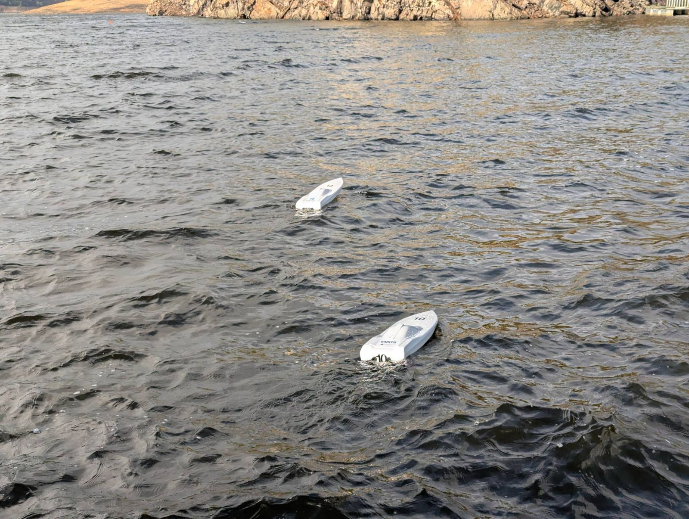
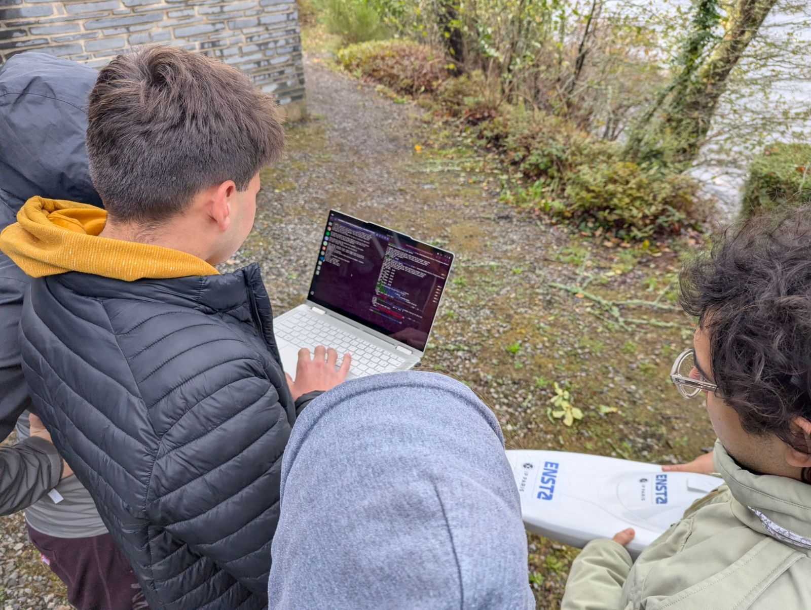
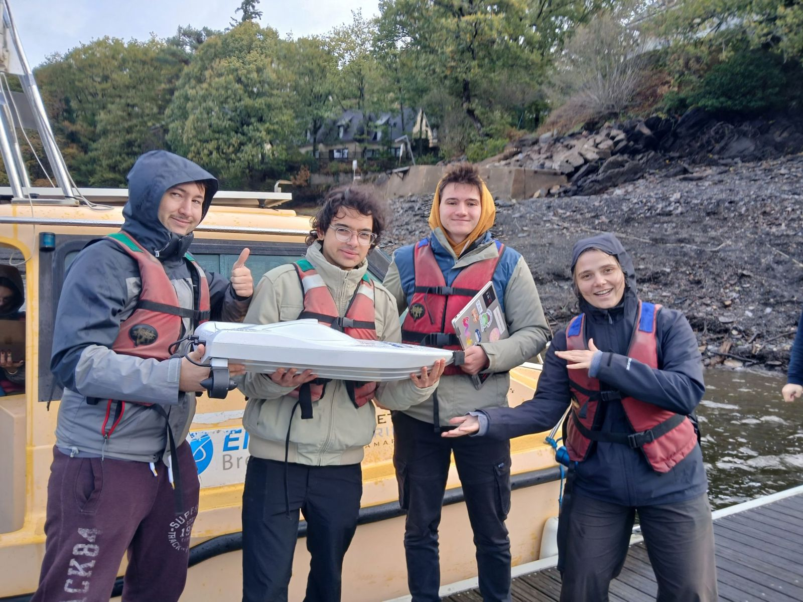

# Autonomous Differential Drive Boat Navigation & IMU Calibration

Autonomous mission and compass calibration for the DDBoat, a small
differential drive robotic boat (two propellers, GPS, 9-axis IMU, Raspberry Pi).
Built by team **granny-amona** during the "ROBOTson Crusoe" Marine Robotics
course at ENSTA Bretagne (Brest and Lake Guerlédan, France), October 2026.



The boat drives itself to a GPS goal, then comes back to where it started.
From a laptop you can start, stop or pause the mission at any time and drive
the boat by hand.

## What's inside

**IMU and magnetometer calibration** ([`lib/calibration.py`](lib/calibration.py), [`lib/imu.py`](lib/imu.py))
The motors and electronics distort the magnetic field the compass measures.
The raw reading is modelled as `x_mag = A·y − b`, where `b` is the
hard-iron offset and `A` the soft-iron distortion. Both are found from four
poses of the boat (bow North, bow South upside down, bow West, bow up), using
the local magnetic inclination, and saved to `calib.npz`. The heading is then
computed from the calibrated field, tilt-compensated with the accelerometer.

**Guidance and navigation** ([`mission.py`](mission.py))
GPS positions are converted to a local frame in metres centred on home
(x = East, y = North). A proportional heading controller steers towards the
target: the heading error `e` to the target gives the two motor commands
`(speed ± e)`, scaled down close to the target. Two legs:

1. **AUTO**: go to the goal.
2. **BACK_HOME**: at the goal, turn around and come back to home.

**Communication loss and safety**
The laptop and the boat talk over UDP on the course WiFi, and the boat never
waits for the laptop:

- In MANUAL, if the laptop is silent for 2 s, the boat goes back to its
  automatic leg (or stops if the mission never started).
- With no GPS fix for 10 s, the motors are turned off.
- Ctrl+C on the boat, or Q / SPACE on the laptop, stops the motors.
- Run the mission inside `screen` so it keeps going when the SSH session
  drops out of WiFi range.



## Repository layout

| Path | Runs on | Purpose |
| --- | --- | --- |
| [`mission.py`](mission.py) | boat (or laptop with `--sim`) | Go to the goal and back home |
| [`client.py`](client.py) | laptop | Keyboard remote control and status display |
| [`lib/calibration.py`](lib/calibration.py) | boat | Compass calibration, saves `calib.npz` |
| [`lib/imu.py`](lib/imu.py) | boat | Calibrated, tilt-compensated heading |
| [`lib/boat_io.py`](lib/boat_io.py) | both | Real boat and simulated boat, same interface |
| [`lib/geo.py`](lib/geo.py) | both | GPS ↔ local metres |
| [`lib/model.py`](lib/model.py) | both | Tank model of the boat (used by the simulation) |
| [`drivers-ddboat-v2/`](drivers-ddboat-v2/) | boat | Hardware drivers provided by the course |
| [`boat-gui/`](boat-gui/) | Steam Deck / laptop | Steam Deck controller with map and telemetry (separate tool, see its README) |
| [`experiments/`](experiments/) | — | Earlier, more complex attempts (digital twin, multi-waypoint routes) |

## Try it without a boat

Needs Python 3 and NumPy:

```bash
pip install numpy
```

Then, in two terminals:

```bash
python3 mission.py 20 30 --local --sim
```

```bash
python3 client.py localhost
```

Press **R** in the client: the simulated boat goes 20 m East and 30 m North,
then comes back home (about 2 minutes). The simulation adds a water current,
GPS noise and compass noise.

## Run it on the boat

Copy the code to the boat (`XX` = boat number) and log in:

```bash
scp -r mission.py lib drivers-ddboat-v2 <user>@172.20.25.2XX:
```

```bash
ssh <user>@172.20.25.2XX
```

Once per boat, calibrate the compass and check the heading
(bow North ≈ 0°, bow East ≈ 90°):

```bash
python3 lib/calibration.py
```

```bash
python3 lib/imu.py
```

Start the mission inside `screen` (`Ctrl+A D` to detach, `screen -r` to come back):

```bash
screen -S mission
```

```bash
python3 mission.py 48.19950 -3.01450
```

The goal is given in latitude and longitude, or in metres from home with
`--local`. On the laptop, run `python3 client.py XX`, wait for the GPS, then
press **R**. Home is set where the boat is at that moment, so put it in the
water first.

| Key | Mode |
| --- | --- |
| R | Start or resume the mission (AUTO or BACK_HOME) |
| P | MANUAL: W/S throttle, A/D turn, C center |
| SPACE | STOP: motors off |
| Q | Stop and quit the client |

## Team



| Name | LinkedIn |
| --- | --- |
| Nemanja Krčo | [LinkedIn](https://www.linkedin.com/in/nemanja-kr%C4%8Do-485930291/) |
| Luigi Agostino | [LinkedIn](https://www.linkedin.com/in/luigi-agostino-mico-57a9b139a/) |
| Coco Schwarz | [LinkedIn](https://www.linkedin.com/in/coco-schwarz-0b537b243/) |
| Unai Olalla | [LinkedIn](https://www.linkedin.com/in/unai-olalla-90b5731b5/) |

The Steam Deck GUI ([`boat-gui/`](boat-gui/)) is Unai's work.

Hardware drivers by the ENSTA Bretagne teaching staff, see
[`drivers-ddboat-v2/`](drivers-ddboat-v2/).

### Why "granny-amona"?

The first time we put the boat on the lake to test our program, it crawled
along and the connection was slow and laggy, so we started calling it the
granny. *Amona* is Basque for grandmother, a nod to Unai.
