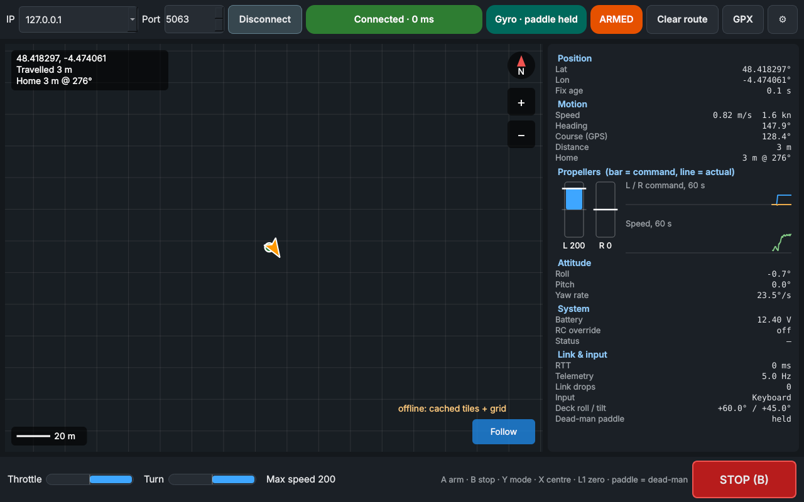

# DDBoat Steam Deck GUI

Drive the DDBoat from a Steam Deck with the sticks or by tilting the Deck
(tilt forward to go, turn it like a wheel to steer),
and see the boat on a map with its route and live telemetry.



## Files

| File | Runs on | Purpose |
| --- | --- | --- |
| `boat_gui.py` | Deck / laptop | Main window |
| `controls.py` | Deck / laptop | SDL2 controller + gyro, dead zone/expo, `mix()` |
| `link.py` | Deck / laptop | TCP link thread, protocol parsing |
| `map_widget.py` | Deck / laptop | OSM tile map with disk cache, route, overlays |
| `telemetry.py` | Deck / laptop | Speed/course/distance, CSV log, GPX export, panel |
| `server_telemetry.py` | **Boat** | `server.py` + telemetry stream; `--sim` mode |
| `tests/test_core.py` | anywhere | `pytest tests` |

## Install on the Steam Deck

Desktop mode, Konsole:

```bash
cd ~/boat-gui && ./install_steamdeck.sh
.venv/bin/python boat_gui.py            # F11 toggles fullscreen
```

On a laptop: `pip install -r requirements.txt && python3 boat_gui.py`
(keyboard works as a controller: W/S/A/D, Enter arm, Space stop, M mode,
C centre map, R re-centre gyro; in Gyro mode W/S tilt, Q/E roll, hold Shift
as the paddle).

## On the boat

Copy `server_telemetry.py` next to `server.py` (the folder that holds
`drivers-ddboat-v2/`) and run it instead of `server.py`:

```bash
python3 server_telemetry.py                    # real hardware, port 5000
python3 server_telemetry.py --sim              # fake boat for testing on land
python3 server_telemetry.py --mag-calib calib.json --heading-offset 0
```

`calib.json` = `{"invA": [[..],[..],[..]], "xbar": [x, y, z]}` (the numbers
from `cap_calib()` in `control_pot.py`). **Check the heading on the water**:
drive straight and compare *Heading* with *Course (GPS)* in the panel; fix it
with `--heading-offset` / `--heading-sign -1`.

The GUI also drives the original `server.py` unchanged (no telemetry, so the
map and panel stay empty).

## Controls

| Input | Action |
| --- | --- |
| Left stick | Joystick mode: Y throttle, X turn |
| R2 / L2 | Joystick mode: forward / reverse throttle |
| Hold any back paddle (L4/L5/R4/R5) | Gyro mode dead-man: the boat only moves while held |
| Tilt Deck forward / back | Gyro mode: throttle / reverse (30° = full, 5° dead zone) |
| Turn Deck like a wheel | Gyro mode: steer (45° = full, 3° dead zone) |
| A | Arm / disarm (sticks must be centred) |
| B or STOP button | Emergency stop (sends `S`, disarms) |
| Y | Switch mode (throttle must be released) |
| X | Centre map on boat / follow |
| L1 | Re-centre gyro: the way you hold the Deck now becomes neutral (also done on entering Gyro mode) |
| D-pad up/down | Max speed ±25 |
| View | Clear route |

### Gyro and Steam Input

The GUI reads the Deck's gyro and back paddles through SDL. If it reports
*no gyro* (Steam may hold the raw device), use the fallback: in Steam, open
the controller layout for DDBoat Control, set **Gyro behaviour → As joystick**
on the **right stick** (tilt forward = stick up), and map a back paddle to
**Right stick click (R3)**, which also counts as the dead-man. Angles and
directions can be changed or inverted in Settings (⚙).

## Safety

- Starts disarmed; disarms on link loss, controller unplug or focus loss.
- Gyro mode sends 0 0 whenever no back paddle is held.
- Commands go out every 0.1 s; if the UI freezes for 0.5 s the link sends `S`.
- The boat's own 1 s watchdog still stops the motors if nothing arrives.

## Protocol

```
GUI -> boat:  M <l> <r>  |  S  |  P <t_ms>
boat -> GUI:  T {"lat":..,"lon":..,"hdg":..,"cmd":[l,r],...}  |  O <t_ms>
```

Logs: `~/boat-gui-logs/session_*.csv`; tiles cache: `~/.cache/boat-gui/tiles`.
